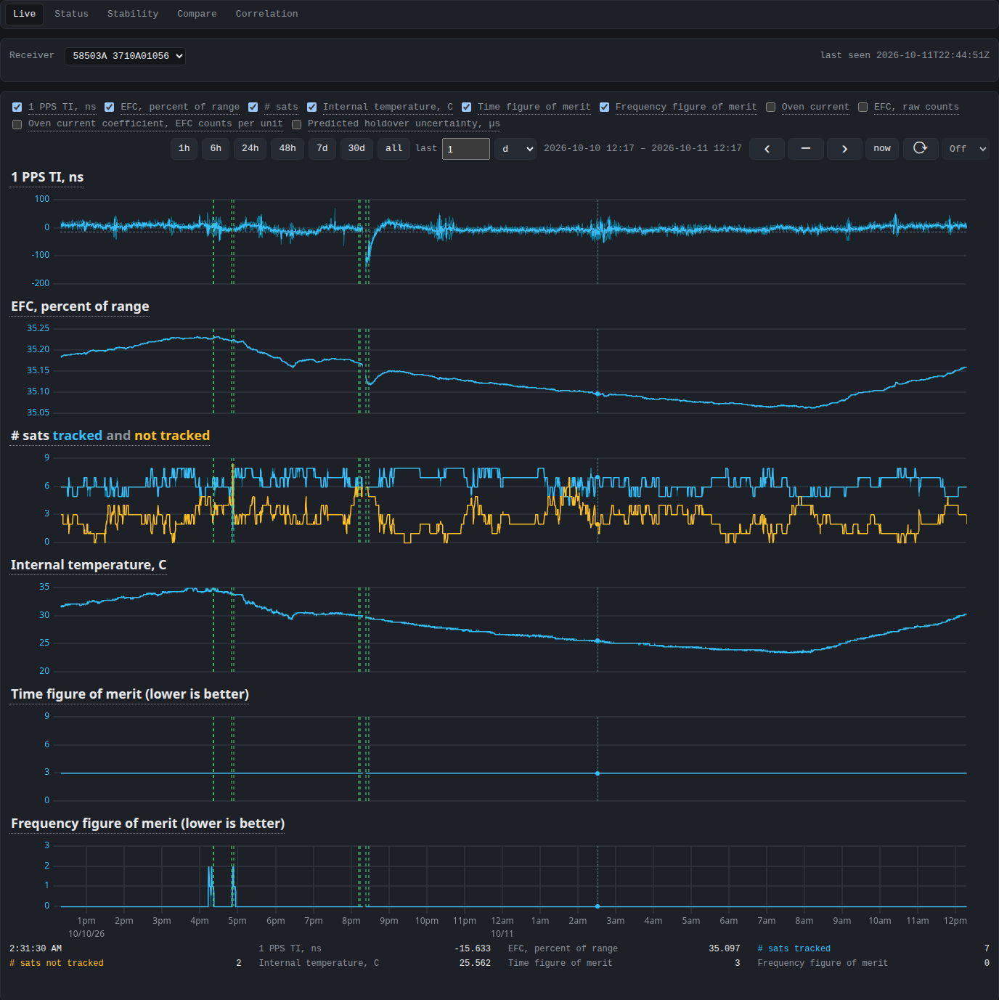
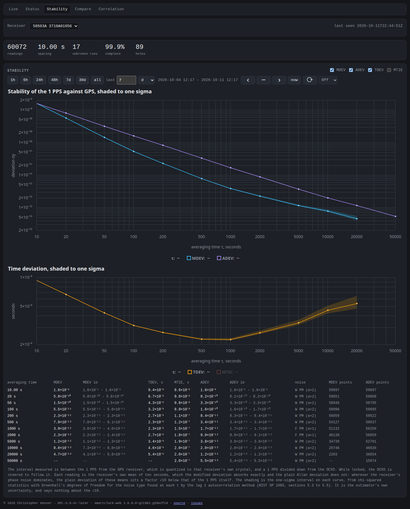
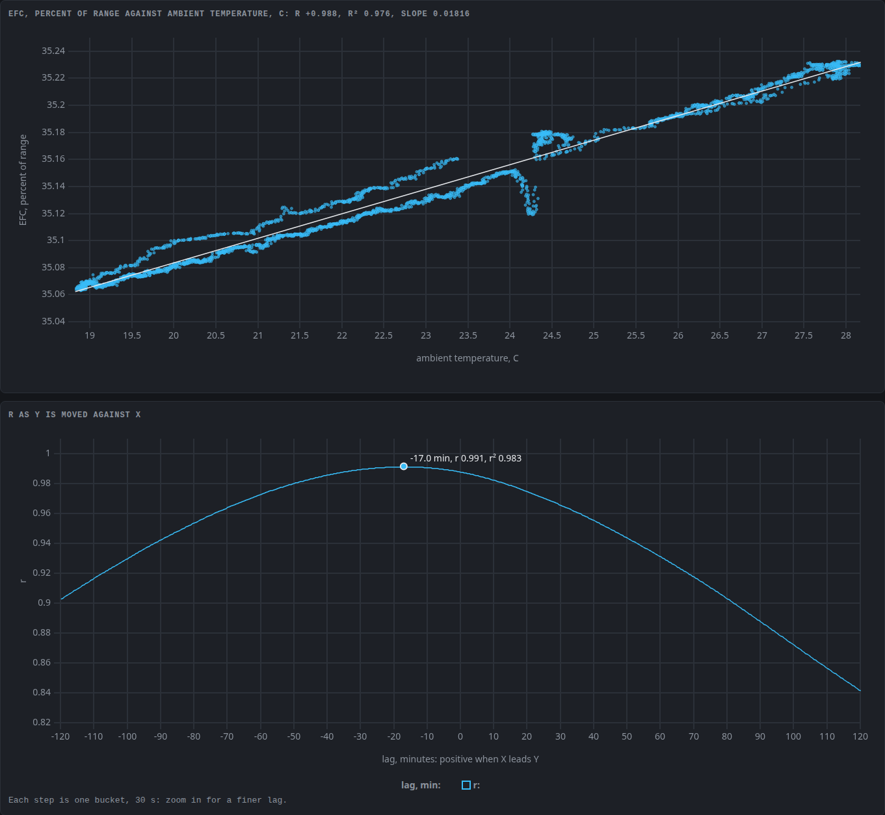
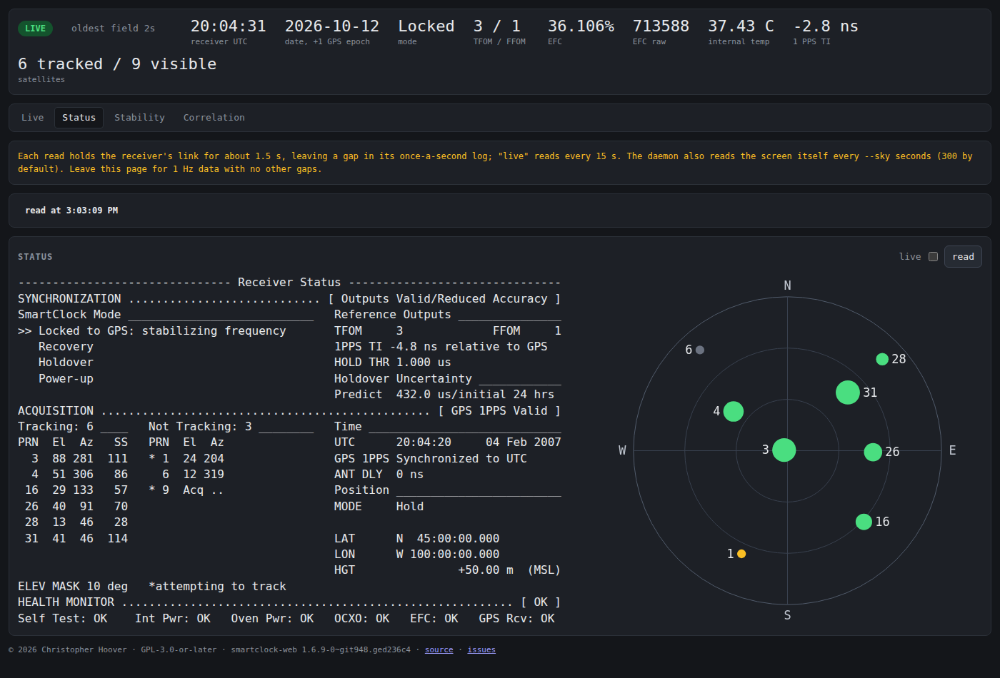
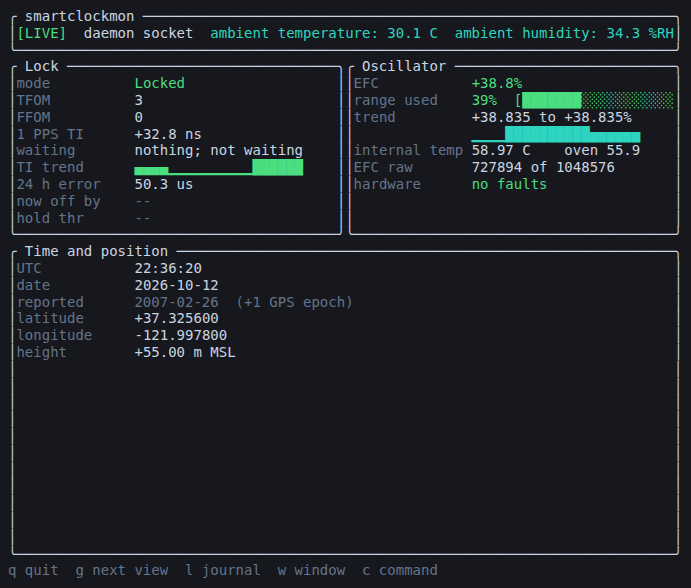
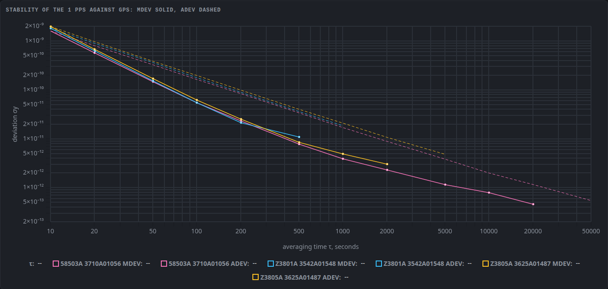

# smartclock

Tools for HP / Agilent / Symmetricom SmartClock GPS time and frequency
receivers -- the 58503A/B, 59551A and Z3801A, Z3805A, Z3815A and Z3816A
-- and a study of how they work, down to their firmware and boards.

The project has three parts:

- **Monitoring** (`smartclockmon`): a Rust library, a logging daemon,
  a terminal monitor, a browser view and a Prometheus exporter, for
  receivers on a serial port.  In daily use, logging continuously.
- **The firmware**: seven ROM images read and documented -- the SCPI
  command trees, the 1 PPS measurement, the disciplining loop, the GPS
  engine interface, the pForth console, the FPGA bitstreams -- and one,
  the Z3805A's 3543B, read whole as hand-written C and checked against
  the image function by function.
- **The hardware**: the boards' parts mapped from photographs, the
  parts' data sheets, and what only a bench can settle, with the
  procedures to settle it.

| Stability, a week | Correlation, EFC against ambient temperature |
| - | - |
|  |  |
| **Status** | **Terminal monitor** |
|  |  |

**Three receivers compared over a week**

The whole pages: [compare](docs/images/web-compare.png),
[correlation](docs/images/web-correlation-page.png).  The history pages
are shown from the bench's logs, the status page against the
simulator; `make screenshots` takes them again.

## Monitoring

| Program | |
| - | - |
| `smartclockd` | holds the serial port, logs to SQLite, serves clients over a Unix socket and, if asked, TCP |
| `smartclockmon` | terminal monitor: dashboard, history graphs, journal, status screen and stability |
| `smartclock-web` | browser view: live state, zoomable history, the status screen, stability, receivers compared, and measures correlated |
| `smartclock-exporter` | Prometheus metrics for every receiver, from the daemons' readings |
| `smartclock-sensord` | logs room temperature, humidity and pressure from hwmon, IIO and TEMPer USB sticks ([design](docs/sensors.md)) |
| `smartclock-cli` | queries, `diagnose`, notes and facts, transcripts, sweeps for undocumented commands, ROM and EEPROM reads, chip dumps joined and split, firmware loading ([notes](docs/firmware/restart.md#the-flasher)), and readers of a firmware image's SCPI tree, console words and Oncore messages |
| `smartclock-sim` | a simulated receiver, in process for tests and over TCP for the real daemon |

The library crates are `smartclock` (transports, SCPI framing, the
command table, parsers, the status screen scraper, the polling task,
the Allan deviation), `smartclock-log` (the log's schema and readers)
and `smartclock-http` (the server the exporter and web view share).
[`PLAN.md`](PLAN.md) holds the design, open questions and known
defects.

### Running it

Releases carry Debian packages for amd64 and arm64, also in the APT
repository, and an unsupported Windows zip.  Build with `make`, or
`make deb` for a package.  The package runs one daemon per serial
port, named by the port: `systemctl enable --now smartclockd@ttyUSB0`.
[`docs/running.md`](docs/running.md) covers installing, settings,
remote clients and Windows.

Run by hand, the daemon holds the port and everything else is its
client:

    smartclockd --device /dev/serial/by-id/usb-... \
                --log-dir . \
                --socket /tmp/smartclockd.sock

    smartclockmon --daemon /tmp/smartclockd.sock
    smartclock-web --daemon /tmp/smartclockd.sock --log-dir .        # http://127.0.0.1:9980/
    smartclock-exporter --daemon /tmp/smartclockd.sock               # http://127.0.0.1:9979/metrics

Installed, the web view and exporter need no options: they find every
daemon under `/run/smartclockd` and every log under
`/var/lib/smartclockd`.  A client on another host names a daemon
started with `--listen HOST:PORT` as `--daemon tcp://HOST:PORT`.
[`docs/views.md`](docs/views.md) says what each view shows and why.

Without a receiver, use the simulator; every tool takes
`tcp://host:port` for a device path:

    smartclock-sim 127.0.0.1:5025            # --model z3801a for a Z3801A, which does not echo
    smartclockd     --device tcp://127.0.0.1:5025 ...
    smartclock-cli  --device tcp://127.0.0.1:5025 diagnose

## The firmware

Seven ROM images -- two of the 58503A, and the 58503B, Z3801A, Z3805A,
Z3815A and Z3816A -- read off bench units through the pForth debug
console or gathered from others.  [`docs/firmware/`](docs/firmware/)
documents them and [`docs/scpi/`](docs/scpi/) their command trees.

### The Z3805A 3543B in C

One image, the Z3805A's 3543B, is read whole as C.  Every C function
of it and of the installer it unpacks into RAM, 1318 and 236, was
decompiled by Ghidra through the project's scripts and then written
again by hand, and each runs in an emulator harness against the
image's own copy from the same state, its results, memory, kernel
calls and device accesses compared: all agree but six whose
difference is the firmware's own or one C cannot express, and one the
harness cannot run.  The 474 routines that are not C, the pSOS and
pForth kernels among them, are the image's instructions, reassembled
byte for byte, and the generated SCPI trees are the ROM's bytes.  It is
a reading of the firmware, not a buildable or flashable image, and the
firmware's faults are kept, not fixed.  Method, checks and limits:
[`docs/firmware/rewrite.md`](docs/firmware/rewrite.md).  The 58503A
3704 follows.

The checks run in CI (`.github/workflows/firmware.yml`;
[`docs/firmware/README.md`](docs/firmware/README.md), "The checks in
CI"), and a Ghidra run from the bare image reproduces the checked-in
export byte for byte.

## The hardware

HP / Agilent / Symmetricom SmartClock receivers: GPS-disciplined OCXO
references with 10 MHz and 1 PPS outputs, reporting over a serial port
in SCPI.

| Model  | Tested | Notes |
| ------ | ------ | ----- |
| 58503A | yes | Primary development target |
| Z3801A | yes | Different response formats |
| Z3805A | yes | Answers as the Z3801A; its firmware read as C |
| 58503B | no; may work | Firmware studied |
| 59551A | no; may work | No commands for its pulse output or time tags |
| Z3816A | no; may work | Firmware studied |
| Z3815A | no; may work | Firmware studied; Furuno GPS engine |

The tools choose a dialect from `*IDN?`: the 58503A's for the
58503A/B and 59551A, the Z3801A's for the others
([`docs/commands.md`](docs/commands.md)).

Their mid-1990s Motorola GPS engines predate the week rollovers of
1999 and 2019, so a unit reports a date 1024 weeks in the past.  Time
of day, 1 PPS and 10 MHz are unaffected; the tools correct the date.
Factory serial settings are 9600 8N1; the Z3801A's port is fixed at
19200 7O1.  When the configured settings get no answer, the daemon,
monitor and CLI probe 19200 and 9600 at 8N1 and 7O1.

The Z3805A's board is mapped part by part on its photograph
([`docs/z3805a-board.html`](https://htmlpreview.github.io/?https://github.com/charlieh0tel/smartclock/blob/main/docs/z3805a-board.html)),
with the identified parts' data sheets under `third_party/`.
[`docs/bench.md`](docs/bench.md) describes the bench, and
[`docs/hardware-investigations.md`](docs/hardware-investigations.md)
what only it can settle.  The HP 53131A-family counters are built on
the same platform ([`docs/hp5313x.md`](docs/hp5313x.md)).

## Development

`make ci` runs CI's Rust checks; the firmware's checks are their own
CI job.  `make test-web` runs the browser tests, after `make web-deps`
once.  `make hooks`, once per clone, sets up the repository's git
hooks.  `make check-pages` loads each HTML page in `docs/` in headless
Chrome and fails if anything on it scrolls sideways at desktop width.

## Documentation

| File | Contents |
| ---- | -------- |
| [`docs/running.md`](docs/running.md) | installing, configuring, remote clients, Windows, and what the daemon does to the receiver |
| [`docs/views.md`](docs/views.md) | what the monitor, browser pages and exporter show, and why |
| [`docs/stability.md`](docs/stability.md) | how the stability curves are computed, checked and measured |
| [`docs/protocol.md`](docs/protocol.md) | how the receivers behave on the wire |
| [`docs/commands.md`](docs/commands.md) | the command table: each tree's commands, how far each is confirmed, and those in no manual; generated by `make docs` |
| [`docs/efc.md`](docs/efc.md) | how the receiver reports its control voltage, measured at the oscillator's EFC pin |
| [`docs/ocxo.md`](docs/ocxo.md) | the oscillator |
| [`docs/58503a-second-10mhz.md`](docs/58503a-second-10mhz.md) | enabling the 58503A's 10 MHz OUT B, J15 |
| [`docs/sensors.md`](docs/sensors.md) | logging the host's sensors beside the receivers |
| [`docs/firmware/`](docs/firmware/) | the firmware: the 1 PPS measurement, the disciplining loop, the GPS engine interface, the Oncore messages each image sends and decodes, the pForth console, and the Z3805A 3543B in C |
| [`docs/firmware/rewrite.md`](docs/firmware/rewrite.md) | the Z3805A rewrite's method, checks and limits |
| [`docs/loop.html`](https://htmlpreview.github.io/?https://github.com/charlieh0tel/smartclock/blob/main/docs/loop.html) | the disciplining loop as a block diagram, with its update law, constants and closed-loop poles |
| [`docs/scpi/`](docs/scpi/) | SCPI from the firmware: the keyword table, every image's command tree as `smartclock-cli dump-scpi` prints it, and as C data, the trees side by side against the manuals, and what bench receivers answered |
| [`docs/screen-format-strings.md`](docs/screen-format-strings.md) | the status screen's templates, and what drives its mode line |
| [`docs/hardware-investigations.md`](docs/hardware-investigations.md) | what only a bench can settle |
| [`docs/hp5313x.md`](docs/hp5313x.md) | the HP 53131A-family counters, the same platform as the receivers, and what they could tell us |
| [`docs/sessions/`](docs/sessions/) | sessions with the bench receivers as captured: pForth consoles and early wire transcripts |

Vendor manuals are in `third_party/`; `097-59551-02` (59551A/58503A)
and `097-z3801-01` (Z3801A) are the primary references, and
[`third_party/NOTICE`](third_party/NOTICE) lists the rest.

## License

Copyright © 2026 Christopher Hoover.  GPL-3.0-or-later.  See
[`LICENSE`](LICENSE).

The license does not cover `third_party/`; see
[`third_party/NOTICE`](third_party/NOTICE).
