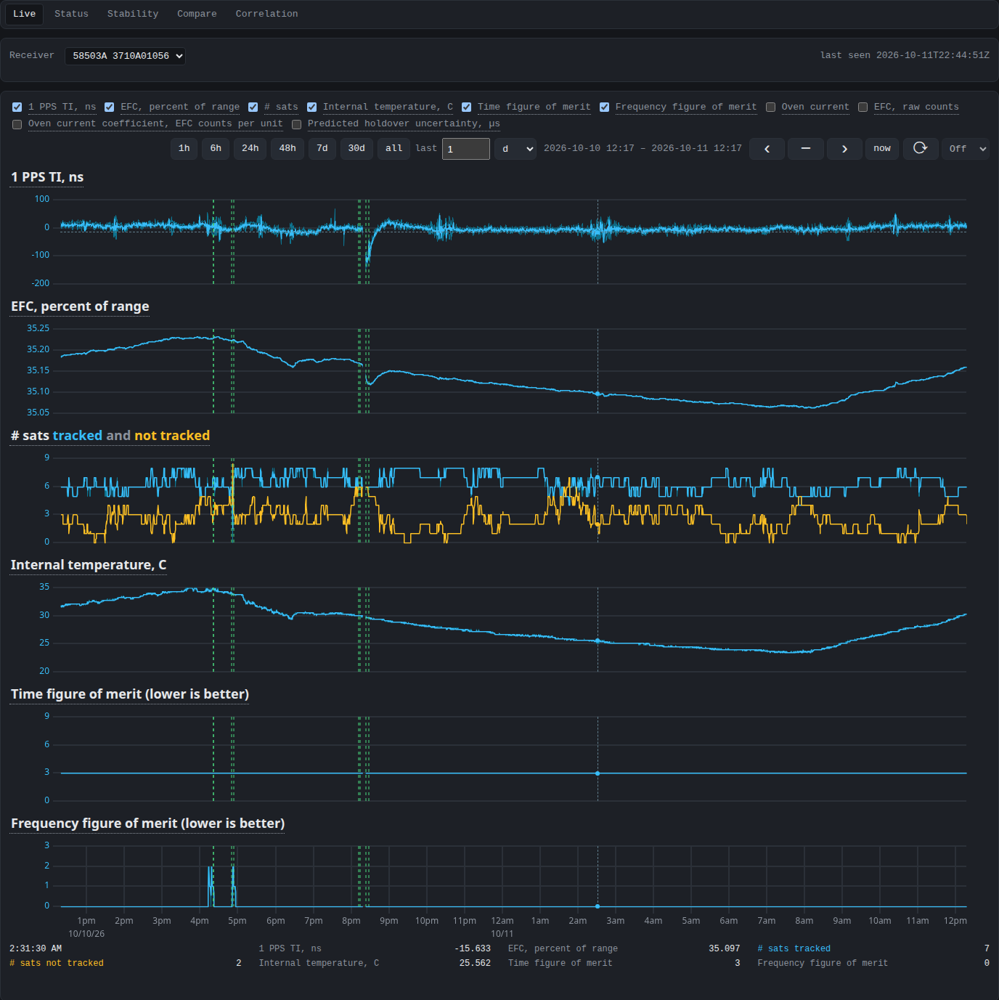
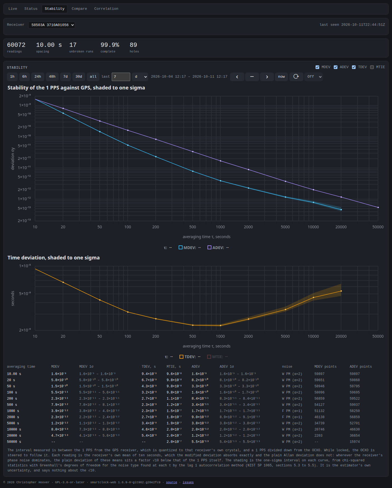
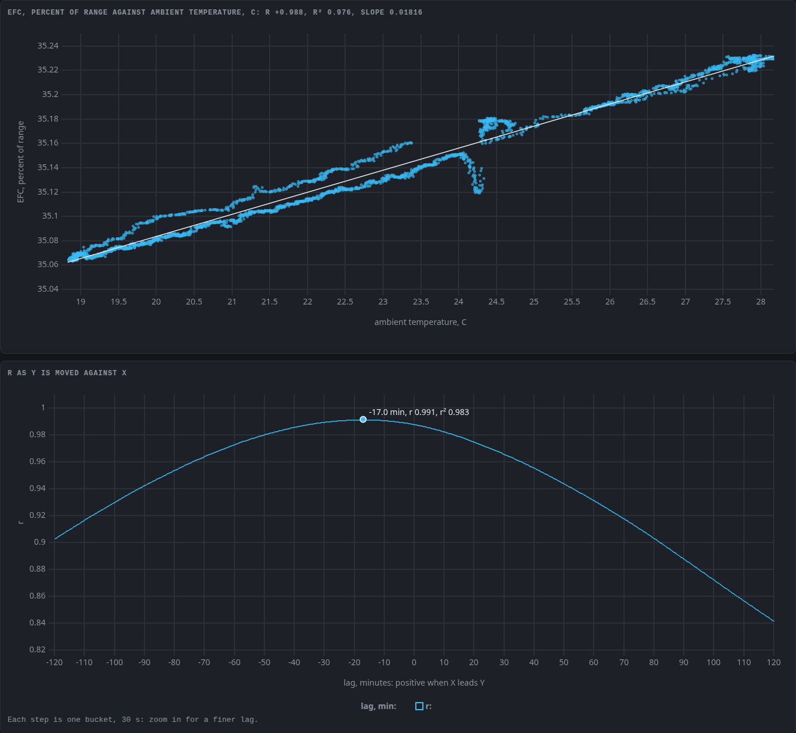
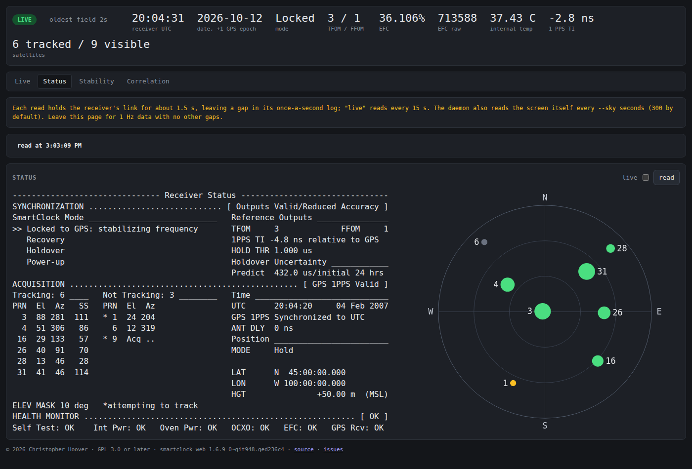
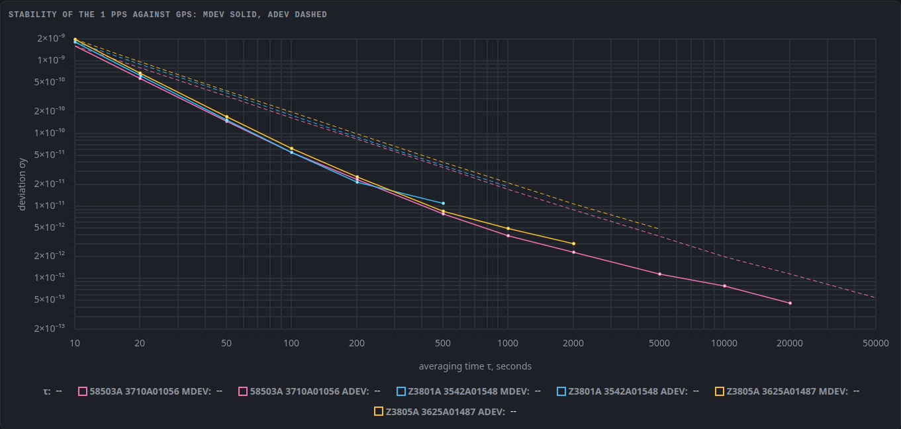

# smartclock

**smartclock**: the HP / Agilent / Symmetricom SmartClock GPS time and
frequency receivers (58503A/B, 59551A, Z3801A, Z3805A, Z3815A, Z3816A,
Z3817A), taken apart and documented.

**Docs site:** the FPGA explainer and detailed diagrams, the board atlas
and block diagram, the loop analysis, the pForth words and the SCPI
trees, and how far each image is covered, at
<https://charlieh0tel.github.io/smartclock/>.

**Where to start:**
[Firmware notes](docs/firmware/README.md)
· [Tooling](docs/tooling.md)
· [Monitoring](docs/monitoring.md)

- **[Firmware](#the-firmware):** nine ROM images read and documented:
  the SCPI trees, the 1 PPS measurement, the disciplining loop, the GPS
  engine interface, the pForth console.  Eight are rewritten whole as C
  and checked against the image function by function.  The loop's
  update law, constants, aging feed-forward and start-up are analyzed
  as a control system ([the loop](https://charlieh0tel.github.io/smartclock/loop.html)), and the images'
  pForth words ([by model](https://charlieh0tel.github.io/smartclock/pforth-models.html)) and SCPI trees
  ([by model](https://charlieh0tel.github.io/smartclock/scpi-models.html)) are set side by side.
- **[Hardware](#the-hardware):** the main board mapped part by part from
  photographs, with the nets measured and the differences between
  models ([the board atlas](https://charlieh0tel.github.io/smartclock/board-atlas.html)),
  and drawn as blocks
  ([the block diagram](https://charlieh0tel.github.io/smartclock/block-diagram.html)).
- **[FPGAs](docs/firmware/fpga-comparison.md):** the six FPGA
  designs in the nine images, decoded from their bitstreams, simulated,
  traced and compared
  ([illustrated](https://charlieh0tel.github.io/smartclock/fpga.html),
  [in detail](https://charlieh0tel.github.io/smartclock/fpga-detail.html)).
- **[Monitoring](#monitoring):** a Rust library, a logging daemon, a
  browser view and a Prometheus exporter, in daily use against real
  receivers.

## The firmware

Nine ROM images -- two of the 58503A, two of the Z3805A, and the
58503B, Z3801A, Z3815A, Z3816A and Z3817A -- read off bench units through the pForth debug
console or gathered from others.  [`docs/firmware/`](docs/firmware/)
documents them and [`docs/scpi/`](docs/scpi/) their command trees.

### Eight images in C

Eight images are rewritten whole as C: every C function of each, and of
the installer it unpacks into RAM, was decompiled by Ghidra through the
project's scripts and then written again by hand, as each image's link
from its hand-written C and assembly alone, every function required,
shows (`make check-link`).  The routines that are not C, the pSOS and pForth kernels among them, are the image's
instructions, reassembled byte for byte, and the generated SCPI trees
are the ROM's bytes.  Each hand-written function runs beside the image's
own copy from the same state, its results, memory, kernel calls and
device accesses compared.  It is a reading of the firmware, not a
buildable or flashable image, and the firmware's faults are kept, not
fixed.

| Image | C functions by hand, primary and installer | Routines kept as assembly | Document |
| ----- | ------------------------------------------ | ------------------------- | -------- |
| Z3805A 3543B | 1318 and 237 | 474 | [`rewrite.md`](docs/firmware/rewrite.md) |
| 58503A 3704 | 1422 and 248 | 468 | [`58503a-3704.md`](docs/firmware/58503a-3704.md) |
| Z3801A 3543 | 1300 and 237 | 467 | [`z3801a-3543.md`](docs/firmware/z3801a-3543.md) |
| Z3815A 4010 | 1663 and 249 | 478 | [`z3815a-4010.md`](docs/firmware/z3815a-4010.md) |
| Z3817A 3752 | 1421 and 249 | 473 | [`z3817a-3752.md`](docs/firmware/z3817a-3752.md) |
| Z3816A 4001 | 1405 and 249 | 473 | [`z3816a-4001.md`](docs/firmware/z3816a-4001.md) |
| 58503B 1.01.04 | 1473 and 249 | 473 | [`58503b-1.01.04.md`](docs/firmware/58503b-1.01.04.md) |
| Z3805A 1.01.03 | 1570 and 237 | 476 | [`z3805a-1.01.03.md`](docs/firmware/z3805a-1.01.03.md) |

The Z3805A's came first; its function check finds all agree but six
whose difference is the firmware's own or one C cannot express, and none
the harness cannot run.  Its method, checks and limits are those of all
eight.  The 58503A's C began as the Z3805A's and was rewritten to its
own code: of the primary's functions 1418 agree and 4 differ for the
firmware's own reasons, and the installer's 248 agree, none the harness
cannot run; its console sessions agree, 8 of 8.  Its document says what
it has that the Z3805A does not, the front panel among it.  The Z3801A's
3543, the Z3805A's sibling without its SCI driver, is held to the same
checks, and so is the Z3815A 4010, seeded from the 58503A's, which
speaks NMEA to its GPS engine, a GT-74, and switches its output with
another card's; its document lists what its code does not establish.
The Z3817A 3752, seeded from the Z3815A's and the 58503A's, a timing
module with no GPS engine of its own that disciplines its oscillator to
one of two references, each a pulse and an Oncore stream, is held to
them too, and so is the Z3816A 4001, seeded from the 58503A's and the
Z3815A's, which carries a Motorola Oncore's code as the 58503A does and
takes its commands on the one host port, and the 58503B 1.01.04, seeded
from the Z3817A's and the Z3816A's, the 58503A's successor, which has
an ACIA and the processor's SCI where the others have a DUART, and the
Z3805A 1.01.03, seeded from the 58503B's and the Z3815A's, a Z3805A
whose GPS engine is a Furuno, spoken to as the Z3815A's is.

The C the eight run alike lies once, in
`third_party/firmware/rewritten/common/`, moved there only by the rules
of [`rewrite.md`](docs/firmware/rewrite.md), "Shared C"; each image's
own C is in `rewritten/IMAGE/`.  The firmware tree is split by kind --
the vendors' images, Ghidra's exports, our C and our analysis --
as [`third_party/firmware/README.md`](third_party/firmware/README.md)
maps.  The checks run in CI (`.github/workflows/firmware.yml`;
[`docs/firmware/README.md`](docs/firmware/README.md), "The checks in
CI"), and a Ghidra run from the bare image reproduces the checked-in
export byte for byte.

## The hardware

HP / Agilent / Symmetricom SmartClock receivers: GPS-disciplined OCXO
references with 10 MHz and 1 PPS outputs, reporting over a serial port
in SCPI.

| Model  | Tested | Notes |
| ------ | ------ | ----- |
| 58503A | yes | Primary development target; its 3704 firmware in C |
| Z3801A | yes | Different response formats; its 3543 firmware in C |
| Z3805A | yes | Answers as the Z3801A; its 3543B firmware in C |
| Z3817A | yes | Answers as the Z3801A, less the stubs its 3752 firmware answers -113; its time reference inputs logged |
| 58503B | yes | Firmware studied |
| Z3816A | yes[^z3816a] | Firmware studied |
| 59551A | no; may work | No commands for its pulse output or time tags |
| Z3815A | no; may work | Firmware studied; Furuno GPS engine |

[^z3816a]: Its one serial port also carries its time code, on from
    power-up.  With the time code turned off
    (`:PTIMe:TCODe:CONTinuous OFF`), the tools work as with the others.

The tools choose a dialect from `*IDN?`: the 58503A's for the
58503A/B and 59551A, the Z3801A's for the others
([`docs/commands.md`](docs/commands.md)).

Their mid-1990s Motorola GPS engines predate the week rollovers of
1999 and 2019, so a unit reports a date 1024 weeks in the past.  Time
of day, 1 PPS and 10 MHz are unaffected; the tools correct the date.
Factory serial settings are 9600 8N1; the Z3801A's port is fixed at
19200 7O1.  When the configured settings get no answer, the daemon
and CLI probe 19200 and 9600 at 8N1 and 7O1.

The first-family main board, the Z3805A's, is mapped part by part on
its photographs, with the firmware's address for each part and the
nets measured so far
([the board atlas](https://charlieh0tel.github.io/smartclock/board-atlas.html)),
with the identified parts' data sheets under `third_party/`, and drawn
as blocks and signals, each marked by how it is known
([the block diagram](https://charlieh0tel.github.io/smartclock/block-diagram.html)).
[`docs/bench.md`](docs/bench.md) describes the bench, and
[`docs/hardware-investigations.md`](docs/hardware-investigations.md)
what only it can settle.  The HP 53131A-family counters are built on
the same platform ([`docs/hp5313x.md`](docs/hp5313x.md)).

## Tooling

The firmware, FPGAs and board are read with the project's own tools:
`smartclock-cli`'s console reads, flasher and image readers, the Ghidra
scripts and the rewrite's checks, the FPGA decoder and simulations, and
the board atlas's and pages' builders.
[`docs/tooling.md`](docs/tooling.md) lists each and links its document.

## Monitoring

| Stability, a week | Correlation, EFC against ambient temperature |
| - | - |
|  |  |

**Status**

**Three receivers compared over a week**

The whole pages: [compare](docs/images/web-compare.png),
[correlation](docs/images/web-correlation-page.png).  The history pages
are shown from the bench's logs, the status page against the
simulator; `make screenshots` takes them again.

The daemon holds the serial port and logs; the browser view, the
Prometheus exporter, the sensor service and the CLI's queries are its
clients.  [`docs/monitoring.md`](docs/monitoring.md) lists each
program and library crate and links its document;
[`PLAN.md`](PLAN.md) holds the design, open questions and known
defects.

### Running it

Releases carry two Debian packages for amd64 and arm64, also in the
APT repository, and an unsupported Windows zip.  `smartclock-utils` is
`smartclock-cli` and `smartclock-sim`, with no service; `smartclockmon`
is the daemon, the web view, the exporter and the sensor service, and
requires `smartclock-utils` of its own version.  Build with `make`, or
`make deb` for both packages.  `smartclockmon` runs one daemon per
serial port, named by the port:
`systemctl enable --now smartclockd@ttyUSB0`.
[`docs/running.md`](docs/running.md) covers installing, settings,
remote clients and Windows.

Run by hand, the daemon holds the port and everything else is its
client:

    smartclockd --device /dev/serial/by-id/usb-... \
                --log-dir . \
                --socket /tmp/smartclockd.sock

    smartclock-web --daemon /tmp/smartclockd.sock --log-dir .        # http://127.0.0.1:9980/
    smartclock-exporter --daemon /tmp/smartclockd.sock               # http://127.0.0.1:9979/metrics

Installed, the web view and exporter need no options: they find every
daemon under `/run/smartclockd` and every log under
`/var/lib/smartclockd`; `smartclock-cli daemons` lists those daemons
and the socket each takes as `--daemon`.  A client on another host names a daemon
started with `--listen HOST:PORT` as `--daemon tcp://HOST:PORT`.
[`docs/views.md`](docs/views.md) says what each view shows and why.

Without a receiver, use the simulator; every tool takes
`tcp://host:port` for a device path:

    smartclock-sim 127.0.0.1:5025            # --model z3801a for a Z3801A, which does not echo; z3817a for a Z3817A
    smartclockd     --device tcp://127.0.0.1:5025 ...
    smartclock-cli  --device tcp://127.0.0.1:5025 diagnose

## Development

`make ci` runs CI's Rust checks: formatting, clippy, the tests, the
`no_std` builds of `smartclock-gps`, `smartclock-ubx` and `smartclock-gps-ublox`
(`make check-no-std`, after `make no-std-targets` once) and the API documentation (`make doc`), in
which a rustdoc warning is an error.  The tests include
`make check-engine-vectors`, the Oncore and Furuno models' recorded exchanges;
`make engine-vectors` rewrites their answers from the model.
The firmware's checks are their own CI job.  `make test-web` runs the
browser tests, after `make web-deps` once.  `make hooks`, once per
clone, sets up the repository's git hooks.  `make pages` builds the
HTML pages and their landing page into
`target/pages/` and fails on an error in one: the generated ones from
their sources, which are not committed, and the hand-written ones from
`docs/pages/`, each with a breadcrumb back to the landing page and
the site's icon.  The FPGA explainer's and detail page's need node, Icarus Verilog and
network access to github.com, for the XC3000 viewer's clone
(`docs/firmware/fpga-comparison.md`, "Reproduce"); the pForth words
page's needs uv, for `tools/firmware/pforth_words.py`'s Capstone.  One page is rendered from a
document, the one source: the 58501A prototype's, from
`docs/firmware/58501a.md`, by `tools/markdown_page.py`, with uv for its
markdown-it-py, once `make check-58501a-figures` finds every figure it
quotes current, which needs cargo, node and the viewer's clone too; it is published at its URL, [`58501a-prototype.html`](https://charlieh0tel.github.io/smartclock/58501a-prototype.html),
but left off the landing page, apart from the production models, and
the FPGA explainer links it.  `.github/workflows/pages.yml` publishes them on GitHub
Pages from main, at <https://charlieh0tel.github.io/smartclock/>.
`make board-atlas` builds the board atlas alone, from
`docs/board-atlas.json`, and fails if the data cites a file or section
that does not exist; `make block-diagram` the block diagram, from
`docs/block-diagram.json`, likewise, and fails too on a part the atlas
lacks or a line that does not meet its blocks.  `make check-pages` loads each page in headless
Chrome and fails if anything on it scrolls sideways at desktop width,
or at a phone's anything but a box marked `data-scroll="x"`, which a
page's generator gives each table, figure or listing meant to scroll
inside its own frame; the pages workflow runs it too.

## Documentation

| File | Contents |
| ---- | -------- |
| [`docs/tooling.md`](docs/tooling.md) | the reverse-engineering and analysis tools, each linked to its document |
| [`docs/monitoring.md`](docs/monitoring.md) | the daemon, its clients and the library crates, each linked to its document |
| [`docs/running.md`](docs/running.md) | installing, configuring, remote clients, Windows, and what the daemon does to the receiver |
| [`docs/views.md`](docs/views.md) | what the browser pages and exporter show, and why |
| [`docs/stability.md`](docs/stability.md) | how the stability curves are computed, checked and measured |
| [`docs/protocol.md`](docs/protocol.md) | how the receivers behave on the wire |
| [`docs/commands.md`](docs/commands.md) | the command table: each tree's commands, how far each is confirmed, and those in no manual; generated by `make docs` |
| [`docs/efc.md`](docs/efc.md) | how the receiver reports its control voltage, measured at the oscillator's EFC pin |
| [`docs/ocxo.md`](docs/ocxo.md) | the oscillator |
| [`docs/58503a-second-10mhz.md`](docs/58503a-second-10mhz.md) | enabling the 58503A's 10 MHz OUT B, J15 |
| [`docs/oncore-leap-week.md`](docs/oncore-leap-week.md) | the 58503A's Time Reset at the end of GPS week 2441, and the 256-week leap-parameter bugs it resembles |
| [`docs/sensors.md`](docs/sensors.md) | logging the host's sensors beside the receivers |
| [`docs/firmware/`](docs/firmware/) | the firmware: the 1 PPS measurement, the disciplining loop, the GPS engine interface, the Oncore messages each image sends and decodes, the pForth console, and the eight images in C |
| [`docs/firmware/rewrite.md`](docs/firmware/rewrite.md) | the rewrite's method, checks and limits, shown on the Z3805A 3543B, and the rules for shared C |
| [`docs/firmware/58503a-3704.md`](docs/firmware/58503a-3704.md) | the 58503A 3704 against the Z3805A 3543B, and its rewrite |
| [`docs/firmware/z3801a-3543.md`](docs/firmware/z3801a-3543.md) | the Z3801A 3543 against the Z3805A 3543B, and its rewrite |
| [`docs/firmware/z3815a-4010.md`](docs/firmware/z3815a-4010.md) | the Z3815A 4010 against the 58503A 3704 and the Z3805A 3543B, and its rewrite |
| [`docs/firmware/z3817a-3752.md`](docs/firmware/z3817a-3752.md) | the Z3817A 3752 against the Z3815A 4010 and the 58503A 3704, and its rewrite |
| [`docs/firmware/z3816a-4001.md`](docs/firmware/z3816a-4001.md) | the Z3816A 4001 against the 58503A 3704 and the Z3815A 4010, and its rewrite |
| [`docs/firmware/58503b-1.01.04.md`](docs/firmware/58503b-1.01.04.md) | the 58503B 1.01.04 against the Z3817A 3752 and the Z3816A 4001, and its rewrite |
| [`docs/firmware/z3805a-1.01.03.md`](docs/firmware/z3805a-1.01.03.md) | the Z3805A 1.01.03 against the 58503B 1.01.04 and the Z3815A 4010, and its rewrite |
| [`third_party/firmware/`](third_party/firmware/README.md) | the ROM images, Ghidra's exports, the rewritten C and the analysis, split by kind |
| [`docs/firmware/fpga-comparison.md`](docs/firmware/fpga-comparison.md) | the six FPGA designs the nine images load, decoded from their bitstreams, simulated and compared; each design's trace beside it |
| [`fpga.html`](https://charlieh0tel.github.io/smartclock/fpga.html) | the six FPGA designs illustrated: the count, the two families, the telecom pair's phase detector and what of P7 reaches the firmware, with waveforms from the simulations; built by `make fpga` and checked by `check-explainer` |
| [`fpga-detail.html`](https://charlieh0tel.github.io/smartclock/fpga-detail.html) | each FPGA design drawn twice by one generator: the whole chip, its pins on the frame and its function blocks in the signal's flow, the counters with their moduli and the nets between them named; and the time-interval counter gate by gate, each logic block with its equations; every element listed below with its trace's confidence word and section; a click opens a drawing full screen at its own scale to pan and zoom; pins, equations and connections read from the decoded netlists; built by `make fpga-detail` and checked by `check-detail` |
| [`loop.html`](https://charlieh0tel.github.io/smartclock/loop.html) | the disciplining loop as a block diagram, with its update law, constants and closed-loop poles, and the FFOM its start-up gives |
| [`gps-architecture.html`](https://charlieh0tel.github.io/smartclock/gps-architecture.html) | the GPS crates drawn together: one copy of the code and the places it runs, a microcontroller board in a SmartClock's Oncore socket and `smartclock-gps-feed` on a host, each with its own provider and engine; who acts on each setting, who makes the 1 PPS, and where each part lives |
| [`board-atlas.html`](https://charlieh0tel.github.io/smartclock/board-atlas.html) | the first-family main board, part by part on its photographs: each part's role, its address or QSPI device, the nets measured, and the Z3801A's and 58503A's boards against it; a ring or a row opens the part's card, the photos zoom and pan, the parts filter by subsystem, confidence or text, and `#J4` links to a part; built from `docs/board-atlas.json` by `make board-atlas` |
| [`block-diagram.html`](https://charlieh0tel.github.io/smartclock/block-diagram.html) | the same board as blocks and signals: the oscillator, the FPGA's count, port and 1 PPS outputs with their pins, the interpolator drawn as a hypothesis, the processor and what it drives, each marked read, board, simulated, inferred or open and cited; on a narrow screen a tap opens the diagram full screen to pan and zoom; built from `docs/block-diagram.json` by `make block-diagram` |
| [`pforth-models.html`](https://charlieh0tel.github.io/smartclock/pforth-models.html) | every image's pForth words side by side, each with its code address, flags and stack effect, filtered by text, by table and image, to the words that differ or those every image shares; built by `make pforth-models` |
| [`docs/scpi/`](docs/scpi/) | SCPI from the firmware: the keyword table, every image's command tree as `smartclock-cli dump-scpi` prints it, and as C data, the trees side by side against the manuals, and what bench receivers answered |
| [`scpi-models.html`](https://charlieh0tel.github.io/smartclock/scpi-models.html) | every image's SCPI paths side by side against the manuals, filtered by text, subsystem and image, by whether a manual lists a path, the images differ or it has a handler; a path in no manual tagged undocumented, linked to its write-up where it has one; built by `make scpi-models` |
| [`coverage.html`](https://charlieh0tel.github.io/smartclock/coverage.html) | how far each firmware image is covered, a row per image: its SCPI tree, pForth words, GPS engine, chip selects, loop constants, rewritten C, FPGA design and daemon support, each Yes linked to its document; built from `docs/coverage.json` by `make coverage`, which fails if a Yes has nothing behind it or a cell that is not a Yes has |
| [`docs/screen-format-strings.md`](docs/screen-format-strings.md) | the status screen's templates, and what drives its mode line |
| [`docs/hardware-investigations.md`](docs/hardware-investigations.md) | what only a bench can settle |
| [`docs/hp5313x.md`](docs/hp5313x.md) | the HP 53131A-family counters, the same platform as the receivers, and what they could tell us |
| [`docs/sessions/`](docs/sessions/) | sessions with the bench receivers as captured: pForth consoles and early wire transcripts |

Vendor manuals are in `third_party/`; `097-59551-02` (59551A/58503A)
and `097-z3801-01` (Z3801A) are the primary references, and
[`third_party/NOTICE`](third_party/NOTICE) lists the rest.

## License

Copyright © 2026 Christopher Hoover.  GPL-3.0-only.  See
[`LICENSE`](LICENSE).

The license does not cover `third_party/`; see
[`third_party/NOTICE`](third_party/NOTICE).
