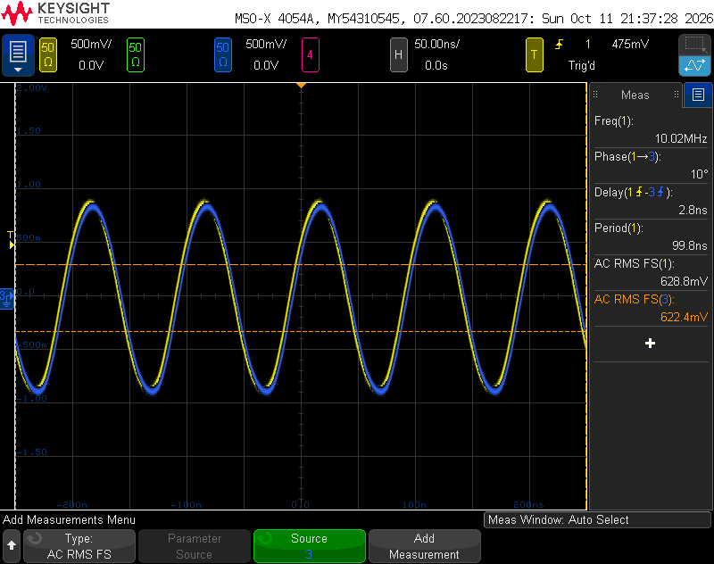

# The 58503A's second 10 MHz output

The 58503A's main board, 58503-60001 (Rev C on the bench unit), has
two 10 MHz output jacks.  J17, "10 MHz A", is cabled to the rear
10 MHz BNC.  J15, "10 MHz B", has its own output stage on the board,
but three resistors in that stage are not fitted, so it is dead.
Fitting them makes J15 a second 10 MHz output, level with the first.
No parts list or service manual is known for this board; what follows
is from the bench unit.

## The two stages

Each output has its own stage.  On the component side, behind J17 are
Q12, Q13 (marked 2907A) and the 78M12 regulator U46; behind J15, Q8,
Q9 and the 78M12 U45.  All of them are fitted on both.

The 10 MHz comes from the oscillator's jack, at the lower left in
this view of the other side, through a network of resistors and
capacitors, to the two stages at the bottom.

## What is missing

On the other side of the board the two stages are laid out alike, J17's
on the left and J15's on the right of the green strip under the CR21
label.  J15's lacks three parts that J17's has, all marked `56R2`,
56.2 Ω, in 0805 (about 2.3 by 1.23 mm):

- a pair side by side beside a capacitor, at the top of the stage, in
  parallel, 28.1 Ω; J17's are black;
- one at the end of the row of three `147R`, 147 Ω; J17's is blue.

The black and blue parts differ in color, not size; why the board mixes
them is not known.  The two stages' black pairs share no node.

## Fitting them

Fit 56.2 Ω 0805 resistors in the three empty footprints on J15's side.
The bench unit took Yageo RC0805JR-0756R, 56 Ω 5 % thick-film 0805s.

## Checking

Terminate J15 and J17 each in 50 Ω and compare them on a scope,
through cables of equal length.  On the bench unit the two read
624.9 mV and 622.8 mV rms, within 0.3 %, about +9 dBm each, and in
phase: 0°, with no delay the scope resolved at 50 ns per division.
Through cables of unequal length they had read 2.8 ns apart.

J15 has no panel connector: a cable from it to the rear panel is the
user's to add.
