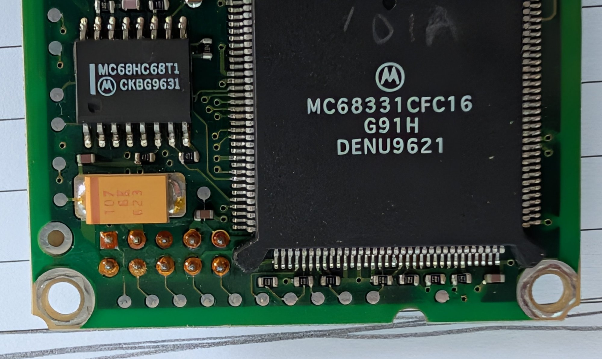
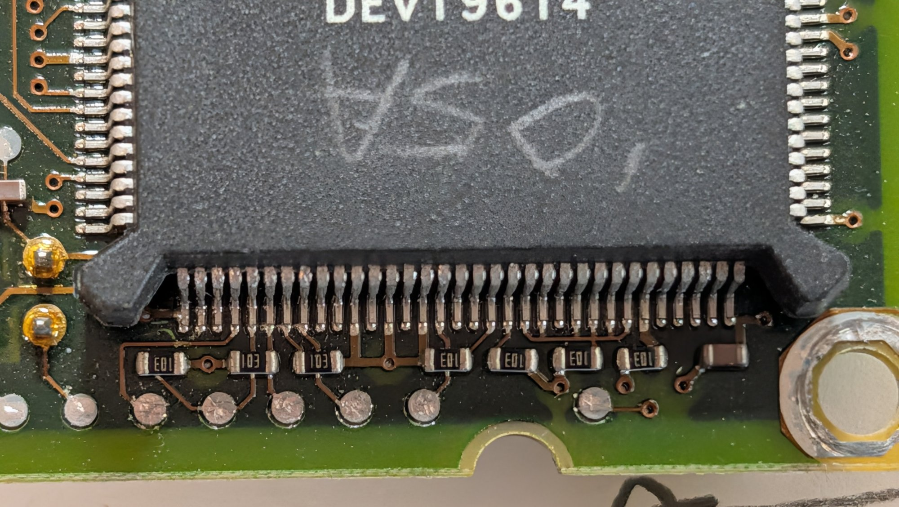
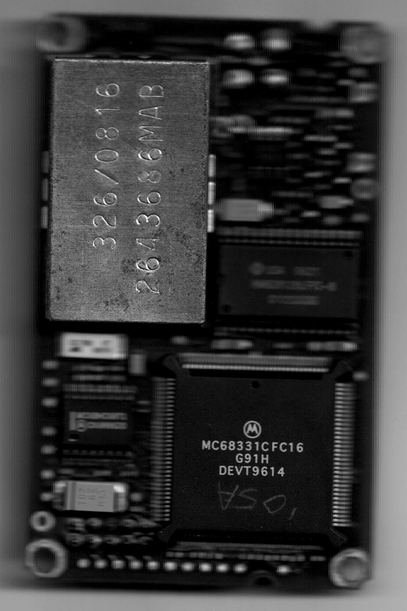

# The Oncore VP's board

The Motorola VP Oncore, the GPS engine the Z3801A, the Z3805A and the
58503A talk to (`firmware/gps.md`), is built around an MC68331.  Its BDM signals come out on test points; it has
no BDM header.  "To confirm" marks what came from a photo or one
buzz-out and still needs a check.  Two boards were looked at, named
here by their MC68331's marking: DENU9621, photographed, and DEVT9614,
traced and scanned, taken to share DENU9621's layout.  A replacement for it,
on a u-blox LEA-M8T, is the
[smartclock-oncore-emulator](https://github.com/charlieh0tel/smartclock-oncore-emulator)
project's.

[`oncore-vp-test-points.html`](https://charlieh0tel.github.io/smartclock/oncore-vp-test-points.html)
labels the test points and the CPU's lower-edge pins on the photo,
and draws the wiring to a 10-pin BDM header.  The photos, in
`images/oncore-vp/`:

| File | What |
| ---- | ---- |
| `oncore-vp-front-denu9621.jpg` | the CPU, the RTC, the GPS header and the test points, on DENU9621 |
| `oncore-vp-lower-edge-devt9614.jpg` | the CPU's lower edge, its pull-ups and B5 to B11, traces visible, on DEVT9614 |
| `oncore-vp-scan-devt9614-600dpi.jpg` | the whole of DEVT9614, component side, 600 dpi, turned to match the photos; the positions below come from it |

## Parts

| Part | What | Source |
| ---- | ---- | ------ |
| MC68331CFC16 | CPU, 16 MHz, 132-pin PQFP | marking |
| TN28F010-120 × 2 | Intel flash, 128 K × 8 each, 120 ns | marking |
| MC68HC68T1 | real-time clock | marking |
| VDD | 5 V (to confirm) | |

The two 28F010s, one per byte lane, are a 16-bit boot ROM of 256 KiB
at `0x000000` to `0x03ffff`, on CSBOOT (to confirm).  CSBOOT's reset
block starts at 0 and is at least 512 KiB (MC68331UM gives 512 KiB and
1 MiB in different places; the 58503A's reads as 1 MiB,
`58503a-bdm.md`, "At a reset entry"), so the flash reads without
chip-select setup and probably repeats from `0x40000`.

## Test points

A row along the board edge below the CPU's lower edge (pins 51 to 83,
left to right; pin 1 at the top center of the package), and a column
at the board's left edge.

| Test point | MC68331 pin | Signal | State |
| ---------- | ----------- | ------ | ----- |
| B1 to B4 | | GPS output header | traced |
| B5 | VSS | GND | buzzed |
| B6 | 54 | IPIPE/DSO | traced |
| B7 | 55 | IFETCH/DSI | traced; 10 kΩ pull-up |
| B8 | 56 | BKPT/DSCLK | traced; 10 kΩ pull-up, same via as B7 |
| B9 | 58 | FREEZE/QUOT | traced |
| B10 | 66 | CLKOUT | traced; not VDD (buzzed) |
| B11 | 68 | RESET | buzzed; trace goes to a via, to the back |
| L6 | VDD | +5 V | buzzed |
| L1 to L5, M1 | | unknown | |

B5 to B11 are a programming fixture's BDM set, with CLKOUT.  BERR
(pin 70) and DS (pin 85, PE5/DS) have no test point.

The resistors below the lower edge are 10 kΩ ("103") pull-ups.  A
bus joining pins 61 (VDDSYN), 63 and 65 (VDD) pulls up pin 57 or 58
(not clear from a photo; a pull-up on 57, TSC, would tristate the
CPU, so 58).  The rest pull up 55 (DSI) and 56 (BKPT) to one via, and
69 (HALT), 70 (BERR), 71 to 77 (IRQ7 to IRQ1, tied together) and 78
(MODCLK) to vias; VDD presumably.  Traced on DEVT9614.

Pin numbers: MC68331UM Figure 3-2.

## Positions

Measured on the 600 dpi scan of DEVT9614, component side, about
±0.2 mm.  Board held as in the photos: component side up, CPU marking
upright, test-point row along the bottom edge.  Origin: the
bottom-left mounting hole's center; x right, y up.

| Feature | x (mm) | y (mm) | x (in) | y (in) |
| ------- | ------ | ------ | ------ | ------ |
| Mounting hole, bottom left | 0.00 | 0.00 | 0.000 | 0.000 |
| Mounting hole, bottom right | 44.34 | 0.00 | 1.746 | 0.000 |
| Mounting hole, top left | -0.20 | 75.81 | -0.008 | 2.985 |
| Mounting hole, top right | 43.83 | 76.30 | 1.726 | 3.004 |
| Notch, bottom edge (semicircle) | 31.85 | -2.75 | 1.254 | -0.108 |
| L6 | -0.27 | 8.89 | -0.011 | 0.350 |
| B1 | 5.40 | -0.56 | 0.213 | -0.022 |
| B2 | 7.98 | -0.56 | 0.314 | -0.022 |
| B3 | 10.52 | -0.57 | 0.414 | -0.022 |
| B4 | 13.02 | -0.43 | 0.513 | -0.017 |
| B5 | 15.50 | -0.36 | 0.610 | -0.014 |
| B6 | 18.05 | -0.46 | 0.711 | -0.018 |
| B7 | 20.58 | -0.59 | 0.810 | -0.023 |
| B8 | 23.16 | -0.56 | 0.912 | -0.022 |
| B9 | 25.62 | -0.58 | 1.009 | -0.023 |
| B10 | 28.24 | -0.64 | 1.112 | -0.025 |
| B11 | 34.54 | -0.64 | 1.360 | -0.025 |

The holes fit a 1.750 × 3.000 in rectangle within the measurement.
B1 to B10 fit a 0.100 in pitch, B11 0.250 in past B10, the row about
0.5 mm below the bottom holes' line.  L6 is on the left holes' line.
The notch's center is on the board edge; its radius, about 1.7 mm, is
from a photo.

## A 10-pin BDM header

The standard CPU32 BDM header (MC68331UM 5.10.2.8, Figure 5-11),
wired from the test points:

| Header pin | Signal | From |
| ---------- | ------ | ---- |
| 1 | DS | CPU pin 85, optional |
| 2 | BERR | CPU pin 70 |
| 3, 5 | GND | B5 |
| 4 | BKPT/DSCLK | B8 |
| 6 | FREEZE | B9 |
| 7 | RESET | B11 |
| 8 | IFETCH/DSI | B7 |
| 9 | VDD | L6 |
| 10 | IPIPE/DSO | B6 |

## Reading the flash over BDM

From a reset entry, halted in background mode:

1. Read SIMCR (`0xfffa00`): bit 14, FRZSW, stops the software
   watchdog while the CPU is halted.  The 58503A's MC68331 reads
   `0x60cf`, FRZSW set, at a reset entry (`58503a-bdm.md`, "At a reset
   entry").
2. Read `0x000000` to `0x03ffff`, 256 KiB.

With VPP at its read level the 28F010s ignore commands, so a stray
write cannot change them (Intel 28F010 data sheet, not in
`third_party/`).  The probe and its host tools are the
[mc683xx-bdm](https://github.com/charlieh0tel/mc683xx-bdm) project's.
